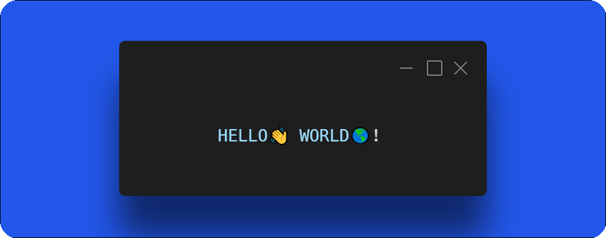
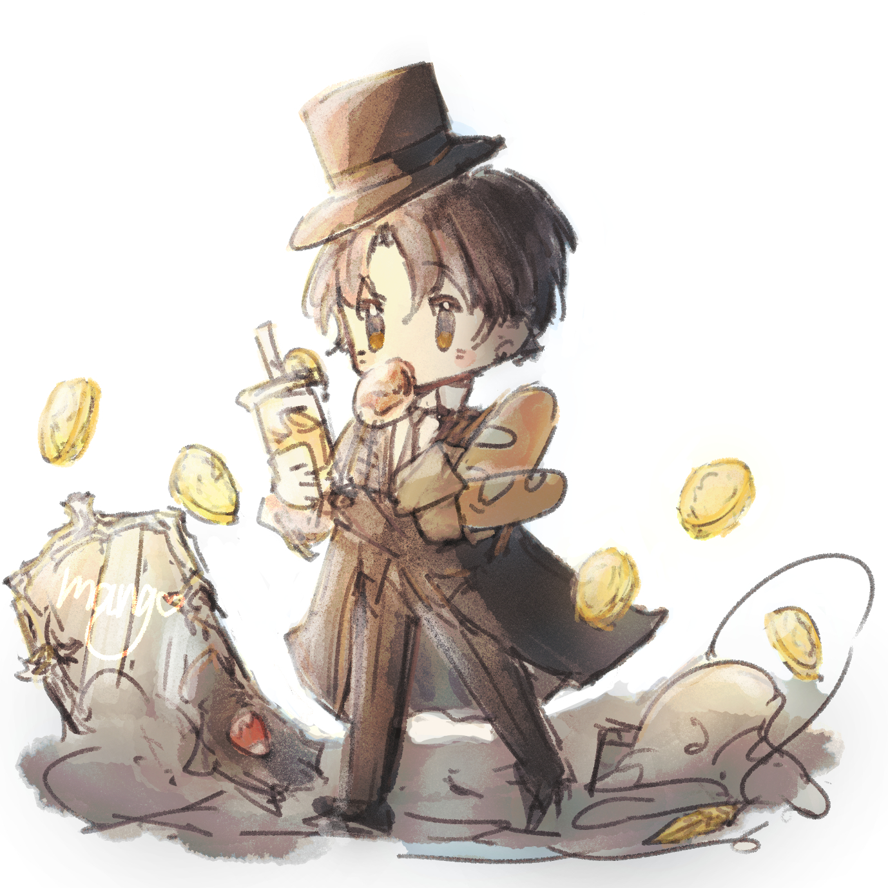
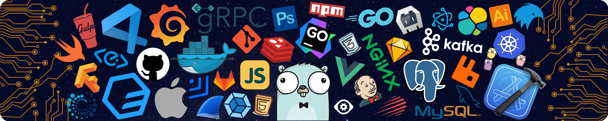

<h1 align="center">𝐇𝐞𝐥𝐥𝐨, 𝐟𝐞𝐥𝐥𝐨𝐰 <𝚌𝚘𝚍𝚎𝚛𝚜></𝚌𝚘𝚍𝚎𝚛𝚜>!  

  

<!--  -->
<!--  -->

---

### Hello

- 🔭 I’m currently studying in Nanjing
- 🌱 Current learning content: Automation Technology and Applications, front-end (sub), etc
- 💬 You can ask me some questions about resources。
- 📫 How to contact my email or official account: kemiaofx@163.com
- 🍉 Active Community：[BLOG](https://blog-v3.kemeow.top) | [Telegram](https://t.me/KemiaoJun) |  [X](https://x.com/kemiaosw/) 

### 👋 个人简介 
---
[个人主页](https://kemiao.online) | [博客站点](https://blog-v3.kemeow.top)

大家好！这里是克喵爱吃卤面的github主页。致力于分享资源、生活日记和踩坑教程，代码水准一般，自动化专业大三学生，现于南京就读，普通的大学牛马。

### :book: 关于我

---

- 🖥 **个性:** 开朗活泼，热爱学习，勤奋工作
- 🖥 **技能:** 自动化技术与应用
- 🖥 **个人信息:**
    - 🧑 **姓名:** mcy
    - 🏫 **学校:** 南京工业职业技术大学，[官方网站](https://www.niit.edu.cn/)
    - 🏛️ **年级:** 大三
    - 👷 **职业:** 学生
- 🖥 **兴趣:** 计算机，单机游戏，电子产品，数码产品，资源分享
- 🖥 **梦想:** 咸鱼算不算？

### 📲 网站运营

| Icon         | Name             | Link                                               |
|--------------|------------------|----------------------------------------------------|
| 🏠 Home      | 个人主页         | [https://kemiao.online/](https://kemiao.online/)  |
| 🪄 Blog      | 个人博客         | [https://blog-v3.kemeow.top/](https://blog-v3.kemeow.top/) |
| 🚀 Memos Speak    | Memos 说说         | [https://moment.kemiaosw.top/](https://moments.kemiaosw.top/) |
| TG Speak | TG 说说 | [https://music.kemiao.online](https://music.kemiao.online) |
| Moment | Moment 朋友圈 | [https://moment.050815.xyz](https://moment.050815.xyz) |
| Ech0 | Echo 说说 | [https://pyq.050815.xyz](https://pyq.050815.xyz) |
| IceFox | IceFox朋友圈 | [https://pyq.kemiao.online](https://pyq.kemiao.online) |
| 相册 | TimePlus | [https://photos.050815.xyz](https://photos.050815.xyz) |
| 🔥 Hot List  | 今日热榜         | [https://news.kemiao.online/](https://news.kemiao.online/) |
| 💾 Resources | 资源分享         | [https://github.com/Kemeow815/kemiaofx](https://github,com/Kemeow815/kemiaofx) |
| 🖥️ Detection | 站点检测         | [https://montor.kemeow.cn/](https://montor.kemeow.cn/) |
| 🎦 Video | 影视网站 | [https://tv.kemeow.top](https://tv.kemeow.top) |
| 🎵 Music | 音乐 | [https://music.kemiao.online ](https://music.kemiao.online)|
| 微信公众号 | 公众号 | [https://wechat.kemeow.top](https://wechat.kemeow.top) |
### 🌟 性格方向 

---
充满热情和理想的 Protagonist（INFJ-T）  
- 🌍 57% 内向  
- 🔮 57% 远见 
- ❤️ 66% 感受  
- 🧠 80% 评判 
- 🌪️ 54% 起伏不定

### 🛠️ 专业技能 

---

     

### 👩🏻‍🏭 通用技能
---
- **语言技能:** 英语，汉语 主打一个全能！
- **办公技能:** Office、Excel、PowerPoint
- **正在学习中**

### :arrow_up: 我的方向

---

- 继续完成大学学业，大概率不考研(没能力)
- 继续个人主页、博客类的搭建
- 争取今年开始资源分享
- ······

### 📝 自我评价 
---
没有领导能力，算是类似打手的性格吧~

## 今年汇总(This year's summary) ✨
---
 

  

  

### 我的成就 🏅

  

## 🚀 我的github活动 
---

  

## ✨ 我的小游戏

<picture>
  <source media="(prefers-color-scheme: dark)" srcset="https://raw.githubusercontent.com/liuchenyang0703/liuchenyang0703/output/github-contribution-grid-snake-dark.svg">
  <source media="(prefers-color-scheme: light)" srcset="https://raw.githubusercontent.com/liuchenyang0703/liuchenyang0703/output/github-contribution-grid-snake.svg">
  
</picture>

### 🤝 Social
<!-- BiliBili数据 -->

  

### Coding time statistics

